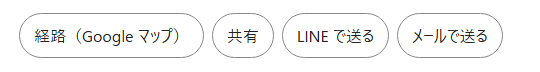

# web-parts

Small, dependency-free parts for web sites, kept in one place and consumed by version. The first part is a set of share buttons that makes no network calls. Documentation below is in Japanese.

複数の Web サイトで共通に使う、小さな部品の置き場です。

## なぜ作ったか

同じ機能（たとえば「このページを人に送る」ボタン）を、サイトごとに別々に作ると、次のことが起きます。

- サイトによって、押したときの動きや、外へ渡す情報が少しずつ違ってくる
- 直すときに、全部のサイトを 1 つずつ直すことになる

ここでは部品を 1 か所で作り、試験で動きを固定します。使う側のサイトは、部品を版の番号つきで取り込みます。部品を直しても、取り込む側が版を上げるまでは、そのサイトの動きは変わりません。

## 入っている部品

| 部品 | できること | 入れ方 |
|---|---|---|
| [share-parts](packages/share-parts/README.md) | ページを人に送るボタン（共有・LINE・メール・経路）。通信をしない | `pnpm add @ishizakahiroshi/share-parts` |

### share-parts



送りたい中身と、ボタンの文言を渡すと、上のようなボタンができます（色と形は、使う側の CSS で付けます）。

```js
import { mountShareButtons } from '@ishizakahiroshi/share-parts/dom'

mountShareButtons(document.querySelector('#actions'), {
  data: { title: '見本の学校', url: 'https://example.com/school/000/' },
  items: [
    { kind: 'share', label: '共有' },
    { kind: 'line', label: 'LINE で送る' },
  ],
})
```

- 「共有」は端末の共有メニューを開き、使えないブラウザでは URL をコピーします
- 利用者が押すまで、どこにも何も送りません
- 経路のボタンは、地図のサービスへ目的地だけを渡します（利用者が設定した地点は渡しません）
- React 用・素の JavaScript 用・関数だけ、の 3 通りで使えます

使い方・設定・守っている決まりは、[share-parts の README](packages/share-parts/README.md) にまとめてあります。

## 部品に共通の決まり

- 通信をしない。計測・広告・SNS への投稿ボタンを入れない
- 文言・色・サイトの名前を持たない（使う側が渡す）
- 決まりは試験にして、破る変更が入ると落ちるようにする
- 試験と見本の値は、作り物だけを使う

## フォルダの中身

```text
packages/
  share-parts/
    src/        部品の本体（core.ts が芯、dom.ts と react.tsx が見た目）
    test/       試験（rules.test.ts が、決まりの試験）
    examples/   見本のページ
    docs/       README の画像
    scripts/    配る形の検査
scripts/        リポジトリの検査
```

## 手元で動かす

Node.js 24 と pnpm 11 で確かめています。

```text
git clone https://github.com/ishizakahiroshi/web-parts.git
cd web-parts
pnpm install
pnpm typecheck    # 型の検査
pnpm test         # 試験
pnpm build        # ビルド
pnpm check:dist   # 配る形の検査
```

## ライセンス

MIT
