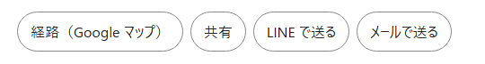

# @ishizakahiroshi/share-parts

Share buttons without tracking: native share (with copy fallback), LINE, mail, and a route link that only passes the destination. A framework-free core with thin React and DOM views. No network calls, no built-in wording, no styles. Documentation below is in Japanese.

Web ページに「このページを人に送る」ボタンを置くための部品です。



上の画像は、この部品が作った 4 つのボタンです（色と形は、使う側の CSS で付けたもの）。

## 何が解決するか

「共有ボタン」は小さな機能ですが、自分で作ると次のことを毎回決めて、毎回試すことになります。

- 端末の共有メニューが使えないブラウザでは、どうするか
- 利用者が共有メニューを閉じたとき、「失敗しました」と出してしまわないか
- LINE やメールへ渡す文は、どう組み立てるか
- 地図アプリへ、利用者の自宅の位置まで渡してしまっていないか

この部品は、その答えを 1 か所にまとめて、試験で固定したものです。使う側は、送りたい中身（件名と URL）とボタンの文言を渡すだけです。

## 入れ方

```text
pnpm add @ishizakahiroshi/share-parts
# または
npm install @ishizakahiroshi/share-parts
```

ほかのパッケージには依存しません。React 用の見た目（`/react`）を使うときだけ、React 18 以上が要ります。

## ボタンごとの動き

| ボタン | 押すと起きること | 外へ渡るもの |
|---|---|---|
| 共有（`share`） | 端末の共有メニューが開き、入っているアプリ（LINE・メール・メモなど）から送り先を選べる。共有メニューが使えないブラウザでは、URL をクリップボードへコピーする | 利用者が選んだアプリへ、件名・本文・URL |
| LINE で送る（`line`） | 件名と URL が入った状態で、LINE の「送る相手を選ぶ」画面が開く | LINE へ、件名・本文・URL をつないだ文 |
| メールで送る（`mail`） | 件名と本文が入った状態で、メールのアプリが開く | 端末のメールのアプリへ、件名と本文（宛先は空） |
| 経路（`route`） | Google マップの経路の画面が、目的地だけ入った状態で開く | Google マップへ、目的地の緯度と経度だけ |

どのボタンも、利用者が押すまで何も外へ出しません。部品そのものは通信をしません。

## 使い方

### React で使う

```tsx
import { useState } from 'react'
import { ShareButtons, type ShareResult } from '@ishizakahiroshi/share-parts/react'

const messages: Record<ShareResult, string> = {
  shared: '共有しました',
  copied: 'リンクをコピーしました',
  cancelled: '', // 利用者が共有メニューを閉じただけ。何も出さない
  failed: '共有できませんでした',
}

export function SchoolActions() {
  const [message, setMessage] = useState('')
  return (
    <>
      <div className="actions">
        <ShareButtons
          data={{ title: '見本の学校', url: 'https://example.com/school/000/' }}
          destination={{ lat: 35.5, lng: 135.25 }}
          items={[
            { kind: 'route', label: '経路（Google マップ）', className: 'chip' },
            { kind: 'share', label: '共有', className: 'chip' },
            { kind: 'line', label: 'LINE で送る', className: 'chip' },
          ]}
          onResult={(result) => setMessage(messages[result])}
        />
      </div>
      <p role="status">{message}</p>
    </>
  )
}
```

`ShareButtons` は、包む要素を作らずに `<button>` と `<a>` だけを並べて返します。そのため、既にあるボタンの行の中へそのまま置けます。

描く時点ではブラウザの機能を調べません（共有メニューが使えるかは、押したときに調べます）。サーバーで先に HTML を作るページでも、ブラウザで描いた結果と食い違いません。

### 素の JavaScript で使う（まとめる道具あり）

```js
import { mountShareButtons } from '@ishizakahiroshi/share-parts/dom'

const messages = { shared: '共有しました', copied: 'リンクをコピーしました', cancelled: '', failed: '共有できませんでした' }

const unmount = mountShareButtons(document.querySelector('#actions'), {
  data: { title: '見本の学校', url: 'https://example.com/school/000/' },
  destination: { lat: 35.5, lng: 135.25 },
  items: [
    { kind: 'share', label: '共有', className: 'chip' },
    { kind: 'line', label: 'LINE で送る', className: 'chip' },
  ],
  onResult: (result) => {
    document.querySelector('#message').textContent = messages[result]
  },
})

// 中身を変えたいとき（別のページの URL にするなど）は、取り除いてから作り直す。
// unmount()
```

`mountShareButtons` は、渡した要素の末尾にボタンを足します。戻り値の関数を呼ぶと、足したボタンだけを取り除きます。

### 素の JavaScript で使う（まとめる道具なし）

ビルドの仕組みが無いサイトでも使えます。パッケージの中の次の 3 つを、サイトの同じフォルダへ写します。

```text
node_modules/@ishizakahiroshi/share-parts/dist/core.js
node_modules/@ishizakahiroshi/share-parts/dist/dom.js
node_modules/@ishizakahiroshi/share-parts/LICENSE
```

`dom.js` は、隣にある `core.js` だけを読み込みます（ファイルの名前は変えないでください）。あとは `<script type="module">` から読み込みます。

```html
<div id="actions"></div>
<p id="message" role="status"></p>
<script type="module">
  import { mountShareButtons } from './vendor/share-parts/dom.js'

  mountShareButtons(document.getElementById('actions'), {
    data: { title: document.title, url: location.href },
    items: [{ kind: 'share', label: '共有' }, { kind: 'line', label: 'LINE で送る' }],
    onResult: (result) => { /* 知らせを出す */ },
  })
</script>
```

### 関数だけを使う

ボタンは自分で作り、中の動きだけを使うこともできます。

```js
import { shareOrCopy, lineShareUrl, mailShareUrl, routeUrl } from '@ishizakahiroshi/share-parts'

button.addEventListener('click', async () => {
  const result = await shareOrCopy({ title: '見本の学校', url: 'https://example.com/school/000/' })
  // result は 'shared' | 'copied' | 'cancelled' | 'failed'
})

lineShareUrl('送る文')                // 'https://line.me/R/share?text=...'
mailShareUrl('件名', '本文')          // 'mailto:?subject=...&body=...'
routeUrl({ lat: 35.5, lng: 135.25 })  // 'https://www.google.com/maps/dir/?api=1&destination=35.5%2C135.25'
```

`shareOrCopy` は、ボタンを押した操作の中から呼んでください。ブラウザは、利用者の操作の外から共有メニューを開くことを許していません。

## 設定

`ShareButtons`（React）と `mountShareButtons`（素の JavaScript）は、同じ設定を受け取ります。

| 項目 | 必須 | 中身 |
|---|---|---|
| `data` | はい | 送る中身。`title`（件名）・`text`（本文）・`url`（ページの URL）。あるものだけを使う |
| `items` | はい | 並べるボタン。書いた順に並ぶ。1 つずつ `kind`・`label`・`className`（省ける）を持つ |
| `destination` | `route` を使うとき | 経路の目的地。`{ lat, lng }`。無い・範囲の外のときは、経路のボタンを出さない |
| `mailSubject` | いいえ | メールの件名。省くと `data.title` |
| `onResult` | いいえ | 「共有」を押した結果を受け取る関数 |

`kind` は `share`・`line`・`mail`・`route` の 4 つです。`label` は必ず渡します（部品は文言を持ちません。日本語でも英語でも、渡した文字がそのまま出ます）。

### 送られる文の形

| 送り先 | 入る文 |
|---|---|
| 共有メニュー | `title`・`text`・`url` を、そのまま渡す |
| コピー（共有メニューが使えないとき） | `text` と `url`。`url` だけを渡していれば、URL だけがコピーされる |
| LINE・メールの本文 | `title`・`text`・`url` を、あるものだけ改行でつないだ文 |

### 「共有」を押した結果

| 値 | 意味 | 画面に出すとよいもの |
|---|---|---|
| `shared` | 共有メニューで共有した | 出さなくてもよい |
| `copied` | 共有メニューが使えず、クリップボードへコピーした | 「リンクをコピーしました」 |
| `cancelled` | 利用者が共有メニューを閉じた | 何も出さない（失敗ではない） |
| `failed` | 共有もコピーもできなかった | 「共有できませんでした」 |

### 見た目

部品は CSS を持ちません。`className` で、サイトに既にあるボタンのクラスを渡してください。作られるのは `<button type="button">`（共有）と `<a>`（LINE・メール・経路）です。新しいタブで開くリンクには `rel="noopener noreferrer"` が付きます。

## 部品が守る決まり

| 決まり | 理由 |
|---|---|
| 通信をしない | 利用者がボタンを押すまで、どこにも何も送らないため。計測のための送信も入れない |
| 経路は目的地だけで作る。出発地を渡す口が無い | 利用者がサイトに設定した地点（自宅など）を、地図のサービスへ渡さないため |
| SNS へ投稿するボタンを持たない | 家族や知人へ送ることと、誰でも見られる場所へ出すことは別のため |
| 共有する URL は https だけを通す | `javascript:` などの URL を、共有やリンクに紛れ込ませないため（開発用に localhost の http は通す） |
| 文言・色・形を持たない | サイトごとの言葉づかいと見た目に合わせられるようにするため |

決まりは `test/rules.test.ts` が確かめています。たとえば、経路の関数に出発地を足す変更や、通信を足す変更を入れると、試験が落ちます。

## よくある質問

**X や Instagram へ投稿するボタンは作れますか。**
作れません。上の決まりのとおり、投稿のボタンは持たせていません。スマホでは「共有」を押すと、端末に入っているアプリが共有メニューに並び、その中から送り先を選べます。

**経路の出発地を、利用者が設定した地点にできますか。**
できません。出発地は Google マップの側が、端末の位置などから決めます。位置が分からないときは、出発地の欄が空のまま開きます。

**「LINE で送る」を PC で押すと、うまく開きません。**
LINE の共有の URL が対象にしているのは、スマホ（iOS・Android）の LINE です。PC の LINE は対象外です。PC では出さない、という出し分けが要るときは、`items` を使う側で切り替えてください。

**「共有」を押しても、共有メニューが出ずにコピーになります。**
共有メニューを持たないブラウザがあります。そのときはコピーに切り替えて、`copied` を返します。

**押したのに何も起きないように見えます。**
結果が `cancelled`（共有メニューを閉じた）のときは、何も出さないのが想定の動きです。`failed` のときに知らせを出したい場合は、`onResult` で受け取って表示してください。

**ボタンの文言を変えたい・英語にしたい。**
`label` に渡す文字を変えるだけです。

## 関数の一覧

`@ishizakahiroshi/share-parts`（芯）が出している関数です。

| 関数 | 中身 |
|---|---|
| `shareOrCopy(data)` | 共有メニューを開く。使えなければコピーする。結果の値を返す |
| `lineShareUrl(text)` | LINE の共有の URL を作る |
| `mailShareUrl(subject, body)` | メールを開く URL を作る |
| `routeUrl({ lat, lng })` | Google マップの経路の URL を作る。数でない・範囲の外のときは `null` |
| `messageText(data)` | LINE・メールの本文にする文を作る |
| `copyText(data)` | コピーする文を作る |
| `isAllowedUrl(url)` | 共有してよい URL かを調べる |
| `cleanShareData(data)` | 空の項目と、通せない URL を外す |
| `planButtons(options)` | 設定から、描くボタンの中身（文言・行き先）の一覧を作る。2 つの見た目は、この結果を描いている |

`/dom` は `mountShareButtons`、`/react` は `ShareButtons` を出しています。型（`ShareData`・`ShareResult`・`ShareButtonsOptions` など）は、3 つの入口のどれからでも読み込めます。

## 外部の URL の出どころ

URL の書き方は、次の公式の資料を 2026-11-14 に確かめたものです。

- LINE: https://developers.line.biz/en/docs/line-login/using-line-url-scheme/
- Google マップ: https://developers.google.com/maps/documentation/urls/get-started
- 共有メニュー（Web Share API）: https://developer.mozilla.org/en-US/docs/Web/API/Navigator/share

## 手元で動かす

```text
git clone https://github.com/ishizakahiroshi/web-parts.git
cd web-parts
pnpm install
pnpm test                                             # 試験
pnpm --filter @ishizakahiroshi/share-parts examples   # 見本のページを開く
pnpm build && pnpm check:dist                         # ビルドして、配る形を検査する
```

見本のページには、素の JavaScript 版と React 版があります。「共有メニューが無い端末として試す」にチェックを入れると、コピーに切り替わる動きを PC でも確かめられます。

## ライセンス

MIT
